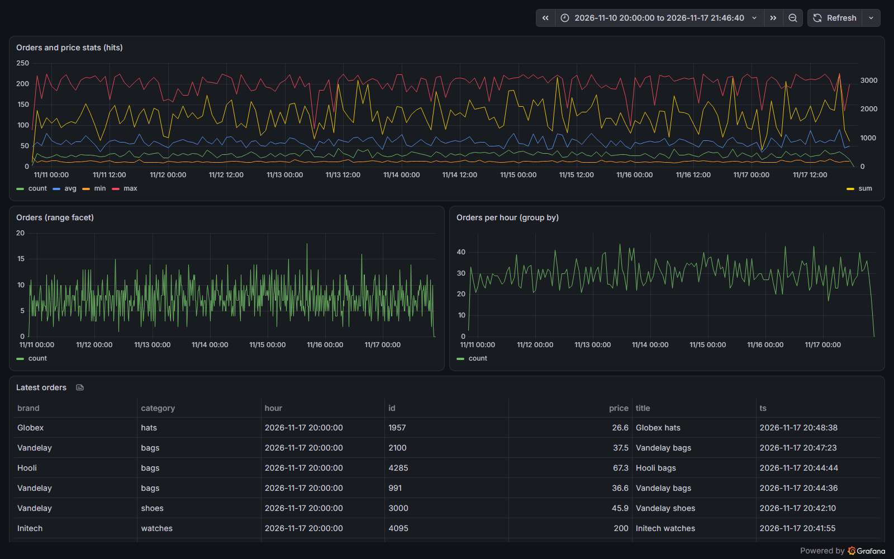
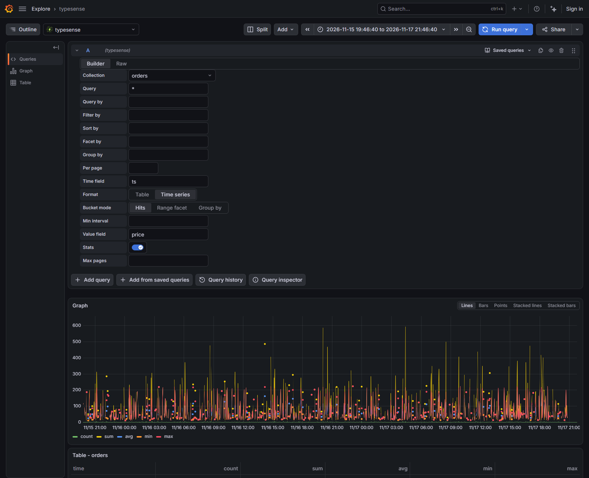
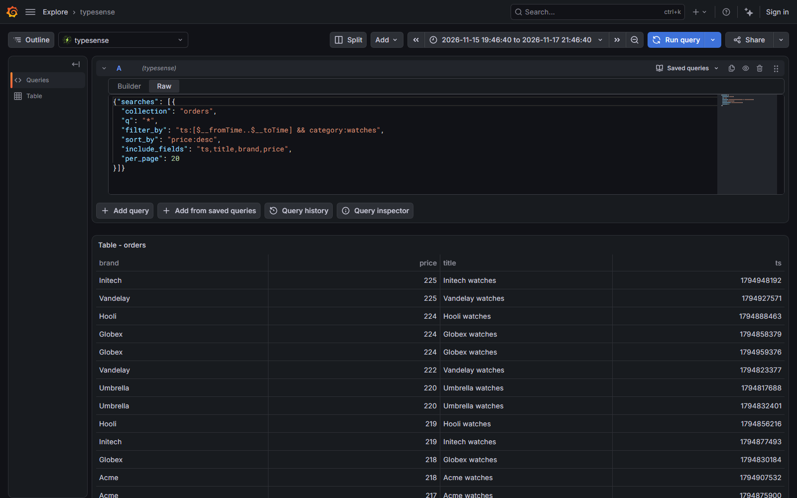
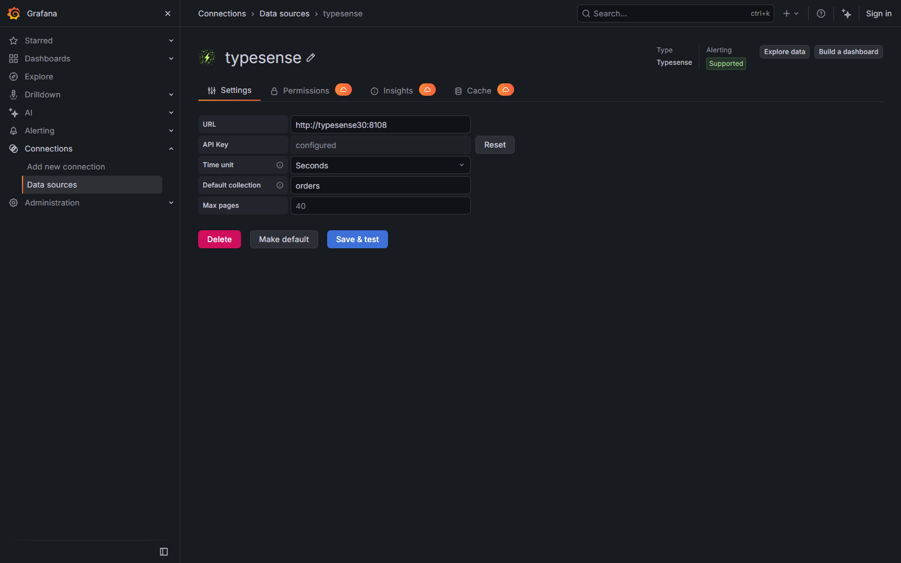

# Typesense data source for Grafana

Query [Typesense](https://typesense.org/) collections from Grafana as tables or time series. The data source runs on the Grafana backend, so queries work in dashboards, Explore, and alert rules.

## Screenshots

## Requirements

- Grafana 13.2 or later
- Typesense v27 or later

## Configuration

Add a new data source of type **Typesense** and fill in these fields:

| Field | Description |
| --- | --- |
| URL | Base URL of the Typesense server, for example `http://localhost:8108`. |
| API Key | Typesense API key. Stored encrypted. |
| Time unit | Unit of the timestamp fields in your collections: Seconds or Milliseconds. Default: Seconds. |
| Default collection | Collection that new queries start with and that **Save & test** searches. Required to test a search-only key. |
| Max pages | Maximum number of result pages fetched per query in **Hits** and **Group by** modes, overridable per query in those modes. Default: 40. |

Click **Save & test** to check the connection. It reports how many collections the key can list and, when a default collection is set, runs a search on it. A search-only key cannot list collections, so the test needs a default collection to succeed.

## Query editor

The editor has two modes.

### Builder

Pick a collection and fill in Query, Query by, Filter by, Sort by, Facet by, Group by, Per page, and Time field. Choose the **Format**: Table or Time series.

### Raw

Write a Typesense `multi_search` request body as JSON. The `$__fromTime` and `$__toTime` macros insert the dashboard time range in the data source's time unit. Raw queries return tables only.

## Time series

With Format set to Time series, choose a **Bucket mode**:

- **Hits**: fetches matching documents and counts them per time bucket. Turn on **Stats** with a numeric **Value field** to also get sum, average, minimum, and maximum per bucket.
- **Range facet**: Typesense counts hits per bucket with a range facet on the time field, so the time field must be a facet. With **Stats** on, the data source runs one search per bucket with a numeric facet field as the **Value field**, and the stats are exact. Stats queries are capped at 50 searches; when the time range needs more buckets, the bucket size is widened automatically and a notice is shown.
- **Group by**: groups hits with `group_by` on a stored field that holds each document's bucket start as Unix time in the data source's time unit. Reports the count only.

Buckets with no hits are shown as 0.

On Typesense v27, Range facet mode with a time field that is not a facet returns zeros instead of an error.

## Template variables

Template variables work in every builder field and in the raw body. In raw mode, a multi-value variable is inserted as a JSON array.

## Alerting

Queries can be used in Grafana alert rules.
